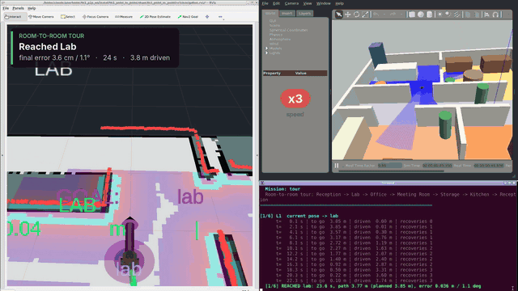
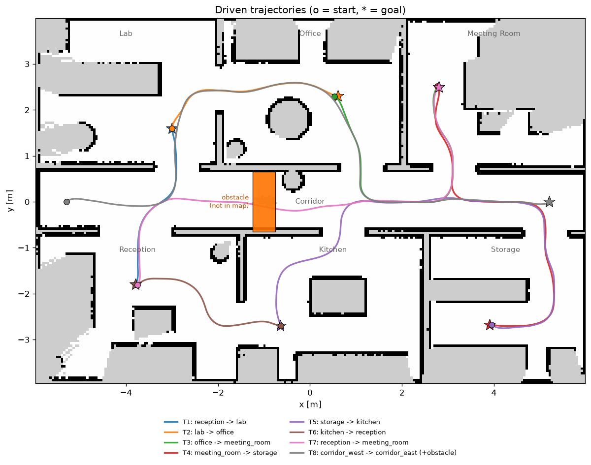

# ROS 2 TurtleBot3 Navigation - indoor point-to-point


A hands-on project for **learning and exploring ROS 2 navigation**. A TurtleBot3 Burger drives
autonomously from room to room in a simulated six-room office: it builds its own map with SLAM
Toolbox, localises itself with AMCL, plans and follows collision-free routes with Nav2, finds a
detour around an obstacle that is not in its map, and measures every trip against Gazebo's ground
truth. Everything runs from one menu, and every part is small enough to read and change.



**Demo video (2 min):** [docs/media/indoor_p2p_navigation_demo.mp4](docs/media/indoor_p2p_navigation_demo.mp4) ·
everything in it runs from one menu: `bash demo.sh`

## What you can learn here

| ROS 2 topic | Where to look |
|---|---|
| Packages, nodes, entry points | `ros2_ws/src/tb3_point_to_point/` (ament_python), `setup.py` |
| Launch files and arguments | `launch/simulation.launch.py`, `navigation.launch.py`, `slam.launch.py` |
| Simulation (Gazebo Classic / Gazebo Sim) and the ROS bridge | `launch/simulation.launch.py`, `worlds/`, `tools/generate_indoor_office.py` |
| TF frames (`map -> odom -> base_footprint`) | [docs/03_HOW_IT_WORKS.md](docs/03_HOW_IT_WORKS.md) section 3.2 |
| SLAM (SLAM Toolbox) and map files | `config/slam_toolbox.yaml`, `explore_and_map.py`, `map_tools.py` |
| Localisation (AMCL) | `config/nav2_params_*.yaml`, [docs/04_EVALUATION.md](docs/04_EVALUATION.md) 4.6 |
| Nav2: planner, controller, costmaps, behaviour tree | `config/nav2_params_*.yaml` (every change is explained in the file header) |
| Actions and lifecycle nodes from Python | `navigator_core.py` (`nav2_simple_commander`, timeouts, lifecycle states) |
| Topics, markers and RViz | `navigator_core.py`, `room_labels.py`, `rviz/` |
| Measuring a robot: metrics and plots | `metrics.py`, `mission_runner.py`, `analyze_results.py` |

## Highlights

* **Custom indoor world** generated from one layout file: 6 rooms + corridor, 1.0 m doors, a
  0.95 m shelf aisle, furniture and alternative routes -> Gazebo Classic and Gazebo Sim worlds,
  an exact ground-truth map and the named goals, always consistent.
* **Autonomous mapping**: SLAM Toolbox while Nav2 drives an exploration route through every room.
* **Named-room goals** (`go_to kitchen`) that are checked against the map before they are sent,
  with live status, planned path and a coloured trail in RViz.
* **Unmapped obstacle challenge**: a block that is not in the map closes the corridor; the LiDAR
  sees it, the costmaps mark it and the planner (re-run every second) takes the rooms instead.
* **Evaluation framework**: every trip is measured (time, path length, final position and heading
  error vs. ground truth, localisation error, recoveries, clearance) and written as Markdown, CSV,
  JSON and plots.
* **One-command demo** on ROS 2 Humble (Ubuntu 22.04) and Jazzy (Ubuntu 24.04).

## Results

Measured against Gazebo's ground truth on ROS 2 Humble + Gazebo Classic (full tables and plots in
[docs/04_EVALUATION.md](docs/04_EVALUATION.md); raw runs in [docs/results/](docs/results/)):

| Test | Result |
|---|---|
| Full test table T1-T8 (8 routes, 62.6 m) | **8/8 reached**, final position error **3.6 cm** mean (max 6.6 cm), heading 5.1°, 0 recoveries |
| Room-to-room tour (6 legs, 37.6 m) | **6/6 reached**, 4.2 cm mean (max 6.9 cm), 0 recoveries |
| Unmapped obstacle across the corridor (2 runs) | **2/2 reached**: the LiDAR sees the block from ~3 m and the robot detours through Reception and the Kitchen, 3.7 cm mean |
| Autonomous mapping (19 waypoints) | **19/19 reached**; mapped walls on average **2.2 cm** from the floor plan, 98.8 % within 5 cm |
| Localisation (AMCL vs ground truth, 1559 updates) | 3.5 cm mean error after calibrating out a half-cell map bias (5.9 cm before) |



## Quick start

```bash
git clone https://github.com/SreevanjiManoharan179/ros2-turtlebot3-navigation.git
cd ros2-turtlebot3-navigation
bash scripts/setup.sh     # once: ROS 2 + Gazebo + Nav2 + TurtleBot3 (asks for your sudo password)
bash scripts/build.sh     # build the ROS 2 package (again after you edit code)
bash demo.sh              # demo menu
```

| Menu | What you see |
|---|---|
| **1** Room-to-room tour | Reception -> Lab -> Office -> Meeting Room -> Storage -> Kitchen -> Reception |
| **2** Go to a room | type a room name (or `x,y,yaw`); the robot drives there and reports its accuracy |
| **3** Obstacle challenge | an orange block **not in the map** closes the corridor; the robot detours through the rooms |
| **4** Full evaluation | test table T1-T8 -> `results/<run>/summary.md`, `trajectories.png`, `metrics.png` |
| **5** Build the map | the robot explores every room by itself while SLAM Toolbox draws the map |
| **6** Drive it yourself | keyboard teleop while mapping |
| **7** Show latest results | prints the last report and opens the figures |
| **8 / 0** | stop everything / exit |

RViz opens on the left (3D camera following the robot, room names, planned path, trail, live
status), Gazebo on the right, and the terminal with live progress below it.

## How it works

| Stage | Tool | Output |
|---|---|---|
| 1. Simulation | Gazebo Classic 11 (Humble) / Gazebo Sim Harmonic (Jazzy), custom indoor world | robot, LiDAR, odometry |
| 2. Mapping | SLAM Toolbox + Nav2 exploration (`explore_and_map`) | occupancy map (`.yaml` + `.pgm`) |
| 3. Localisation | AMCL | robot pose on the map |
| 4. Planning and control | Nav2: NavFn global planner, Regulated Pure Pursuit controller, behaviour tree with re-planning and recoveries | velocity commands |
| 5. Point-to-point | `go_to`, `mission_runner` (Python, `nav2_simple_commander`) | goal validation, live status, missions |
| 6. Evaluation | `metrics.py`, `analyze_results` | success rate, errors, path efficiency, plots |

Details, frames and every tuned parameter: [docs/03_HOW_IT_WORKS.md](docs/03_HOW_IT_WORKS.md).
Why the setup differs from a typical TurtleBot3 tutorial: [docs/06_DESIGN_DECISIONS.md](docs/06_DESIGN_DECISIONS.md).

## Repository layout

```
ros2-turtlebot3-navigation/
├── demo.sh                         start here (menu)
├── scripts/                        setup.sh · build.sh · check.sh · stop.sh · common.sh
├── ros2_ws/src/tb3_point_to_point/ the ROS 2 package
│   ├── tb3_point_to_point/         nodes: go_to, mission_runner, explore_and_map, send_goal, room_labels,
│   │                               analyze_results (+ metrics, map_tools, locations)
│   ├── launch/                     simulation · slam · navigation · bringup
│   ├── config/                     Nav2 parameters (Humble / Jazzy) · SLAM Toolbox · named locations · test scenarios
│   ├── worlds/                     indoor_office.world (Gazebo Classic) · indoor_office_gz.sdf (Gazebo Sim)
│   ├── maps/                       indoor_office (built by the robot) · indoor_office_ground_truth
│   ├── rviz/                       navigation (3D follow view) · overview (top-down)
│   └── test/                       unit tests (pytest)
├── tools/generate_indoor_office.py the building layout -> worlds, exact map, named goals
└── docs/                           documentation, figures and example results (docs/results/)
```

Created at run time and not tracked by git: `results/` (one folder per run), `maps/` (maps you
build), `logs/`, `demo/` (videos).

## Tested on

| Ubuntu | ROS 2 | Simulator | Status |
|---|---|---|---|
| 22.04 | Humble | Gazebo Classic 11 | full test table, tour, obstacle, mapping, `go_to`, demo video - all passing, measured against ground truth |
| 24.04 | Jazzy | Gazebo Sim (Harmonic) | full test table, tour, obstacle, mapping, `go_to`, GUI - all passing (errors measured against AMCL's estimate: Gazebo Sim has no ground-truth odometry) |

## Documentation

1. [Setup](docs/01_SETUP.md) · 2. [Running](docs/02_RUNNING.md) · 3. [How it works](docs/03_HOW_IT_WORKS.md) ·
4. [Evaluation](docs/04_EVALUATION.md) · 5. [Troubleshooting](docs/05_TROUBLESHOOTING.md) ·
6. [Design decisions](docs/06_DESIGN_DECISIONS.md)

## License

Apache License 2.0 - see [LICENSE](LICENSE). Copyright 2026 Bharathwaj Manoharan.
The Nav2 parameter files are derived from Nav2's `nav2_params.yaml` and TurtleBot3's `burger.yaml`
(Apache License 2.0, by the Nav2 project and ROBOTIS); the TurtleBot3 robot models are used from the
installed `turtlebot3_gazebo` package.
