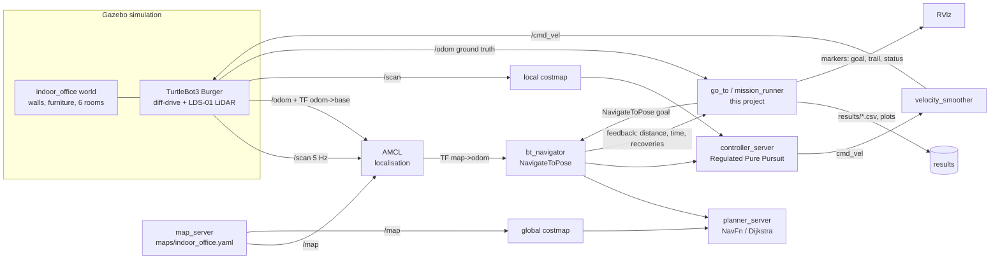

# 3. How it works

## 3.1 System architecture



| Block | Package | Role |
|---|---|---|
| World | `tb3_point_to_point/worlds` | indoor office floor generated by `tools/generate_indoor_office.py` (Gazebo Classic and Gazebo Sim versions from one layout) |
| Robot | `turtlebot3_gazebo` | TurtleBot3 Burger model: differential drive (max 0.22 m/s), 360-sample LiDAR (0.12-3.5 m, 5 Hz) |
| Mapping | `slam_toolbox` + Nav2 | `explore_and_map` drives through every room while SLAM Toolbox builds the occupancy grid |
| Localisation | `nav2_amcl` | particle filter matches each scan against the saved map |
| Global planning | `nav2_planner` (NavFn) | shortest collision-free path on the inflated global costmap |
| Local control | `nav2_controller` (Regulated Pure Pursuit) | follows the global path (look-ahead point 0.3-0.9 m), turns in place when the path is > 45° off, slows down near obstacles and in tight turns, stops if a collision is ahead |
| Behaviour tree | `nav2_bt_navigator` | re-plans every second, runs recoveries (clear costmap, spin, back up, wait) |
| Point-to-point app | **`tb3_point_to_point`** | goal validation, sending goals, measuring each run, missions, obstacle test, reports |

**Analogy.** The map is a floor plan pinned to the wall; AMCL is the robot looking around
with its LiDAR and asking "where on this plan do these walls fit?". The global planner
draws a route on the plan with a marker; the local controller is the driver who follows that
route, slows down in narrow doorways and brakes if something is in the way. Everything the
LiDAR sees is also drawn onto the costmaps, and the behaviour tree asks the planner for a fresh
route every second - so when the orange block in the obstacle test closes the corridor, the
next route simply goes around it through the rooms.

## 3.2 Frames (TF tree)

```
map ──(AMCL)──> odom ──(Gazebo diff-drive)──> base_footprint ──> base_link ──> base_scan
                                                                          └──> wheels, imu
```

In Gazebo Classic the diff-drive plugin publishes the robot's **true world pose** as
odometry, so `odom` = world frame and the project's map is built in that same frame. That
is why `go_to` / `mission_runner` can measure the **true final error** (ground truth) and
the **localisation error** (AMCL estimate vs truth) separately. In Gazebo Sim (Jazzy) odometry
starts at zero, so the metrics fall back to the AMCL estimate (column `ground_truth`).

The map frame is anchored to the building: the SLAM map is shifted so that its walls fit the
floor plan, plus half a map cell because AMCL indexes map cells half a cell lower-left of how
`map_server` and the costmaps do. Measured against ground truth over a whole run, that brought
AMCL's average error from 5.9 cm (with a constant bias of 3-4 cm) down to 3.5 cm (bias ~1 cm).

## 3.3 The project's code (`ros2_ws/src/tb3_point_to_point`)

| File | Purpose |
|---|---|
| `tb3_point_to_point/navigator_core.py` | `P2PNavigator` = Nav2 `BasicNavigator` + ground-truth recording, timeout-safe Nav2 calls, goal/trail/status markers, per-goal metrics |
| `go_to.py` | CLI: one point-to-point goal by room name or `x,y,yaw`; validates the goal on the live map first |
| `mission_runner.py` | tours, the T1-T8 test table, repeats, teleporting to start poses (`/gazebo/set_entity_state`), spawning the unmapped obstacle, CSV/JSON output |
| `explore_and_map.py` | autonomous SLAM run + map saving; with `--reference` it anchors the new map to the building's floor plan and reports how far the mapped walls are from it |
| `send_goal.py` | the minimal action client from the original plan, corrected |
| `metrics.py` | position/yaw error, path length, efficiency, success rate, mean/std (pure Python, unit-tested) |
| `map_tools.py` | reads Nav2 map files exactly like `map_server`, coordinate conversion, goal clearance check, alignment of a map to a floor plan and wall-accuracy report (unit-tested) |
| `locations.py` | named goals (`config/locations.yaml`) and scenarios (`config/scenarios.yaml`) |
| `room_labels.py` | room names and goal spots as RViz markers |
| `analyze_results.py` | `summary.md`, `summary.csv`, `trajectories.png`, `metrics.png` |
| `launch/simulation.launch.py` | Gazebo Classic (Humble) or Gazebo Sim (Jazzy) + robot spawn |
| `launch/navigation.launch.py` | Nav2 bringup with the project map + distro-specific parameters + RViz + labels |
| `launch/slam.launch.py` | SLAM Toolbox (+ Nav2 without AMCL when `explore:=true`) |
| `launch/bringup.launch.py` | simulation + navigation in one command |
| `config/nav2_params_*.yaml` | Nav2 tuned for the Burger and this building (see header of the file for every change) |
| `config/slam_toolbox.yaml` | SLAM Toolbox tuned for the 3.5 m LDS-01 LiDAR |

## 3.4 One point-to-point goal, step by step (`go_to`)

1. Wait until AMCL and `bt_navigator` are **active** (with a timeout - never hangs).
2. Read the live `/map` and **check the goal**: inside the map, on known free space, at least
   0.225 m (robot radius + margin) from obstacles. Bad goals are refused with the reason.
3. Ask the planner for the path (planned length, used for path efficiency).
4. Send `NavigateToPose`; every 0.5 s publish the trail and the status text in RViz, print
   distance-to-go every 2 s.
5. On completion record: result, time (simulation clock), driven length (from ground truth),
   final position and yaw error, localisation error, recoveries, re-plans, closest obstacle.

## 3.5 Key parameters (why they are set like that)

| Parameter | Value | Reason |
|---|---|---|
| `robot_radius` | 0.105 m | Burger footprint 0.138 x 0.178 m |
| `inflation_radius` / `cost_scaling_factor` | 0.6 m / 2.5 | a wide, gentle cost slope: planned paths run through the middle of the 1.0 m doors and the 0.95 m shelf aisle and swing wide around door frames, which all stay passable |
| `obstacle_max_range` = `raytrace_max_range` | 3.0 m | an obstacle seen from 3 m stays in the costmap while the robot detours (with 2.5 / 3.0 m it was erased again and the route flipped back and forth) |
| controller | Regulated Pure Pursuit, 20 Hz | follows the centred path; DWB (TurtleBot3 default) stalled in front of a door in testing |
| `desired_linear_vel`, velocity smoother | 0.22 m/s | TurtleBot3 Burger maximum speed; slower near obstacles, in tight turns and on the final approach |
| `rotate_to_heading_angular_vel` | 0.6 rad/s | turns in place when the path is > 45° off; slow enough to stop on the goal heading instead of coasting past it (at 1.0 rad/s final heading errors were ~13°) |
| goal tolerance | 0.06 m, 0.10 rad | accurate arrival (Nav2 default 0.25 m); the final approach is slowed to 0.05 m/s |
| AMCL `z_hit/z_rand/sigma_hit` | 0.9 / 0.1 / 0.1 m | sharper laser model; with the defaults (0.5/0.5/0.2) the estimate drifted ~0.2 m along the long corridor in testing |
| AMCL `update_min_d/a` | 0.1 m / 0.1 rad | more frequent corrections |
| AMCL `set_initial_pose` | Reception pose | localised from the start, no clicking needed |
| SLAM `do_loop_closing` | false | odometry is near-perfect in simulation; in this symmetric floor plan false loop closures warped the map in testing |
