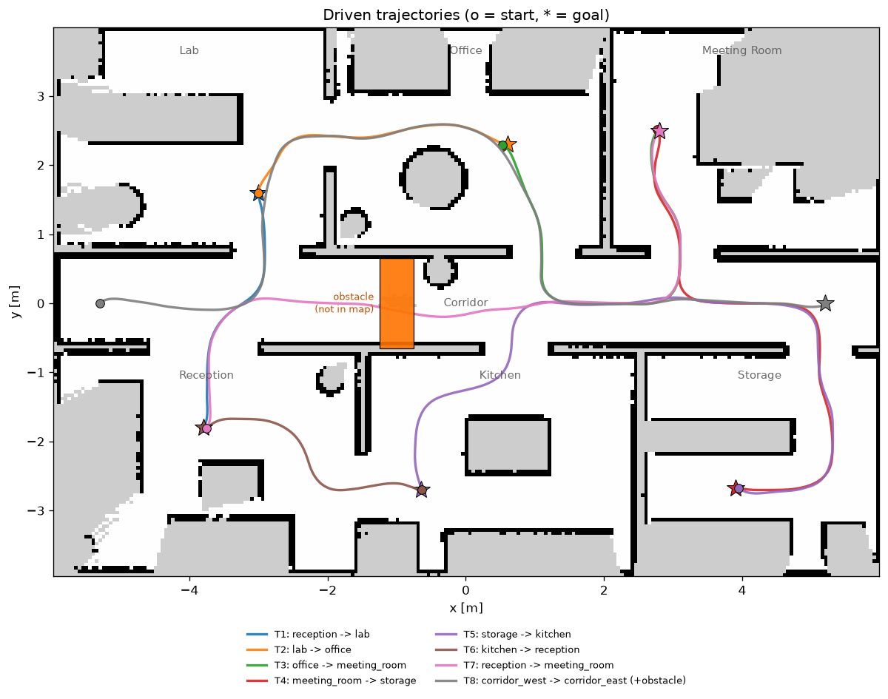
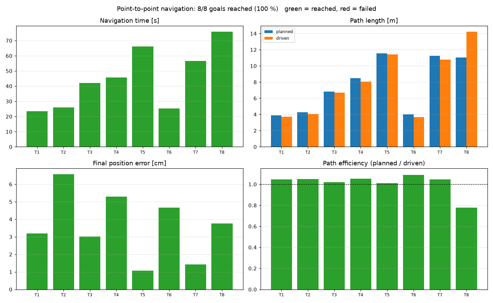
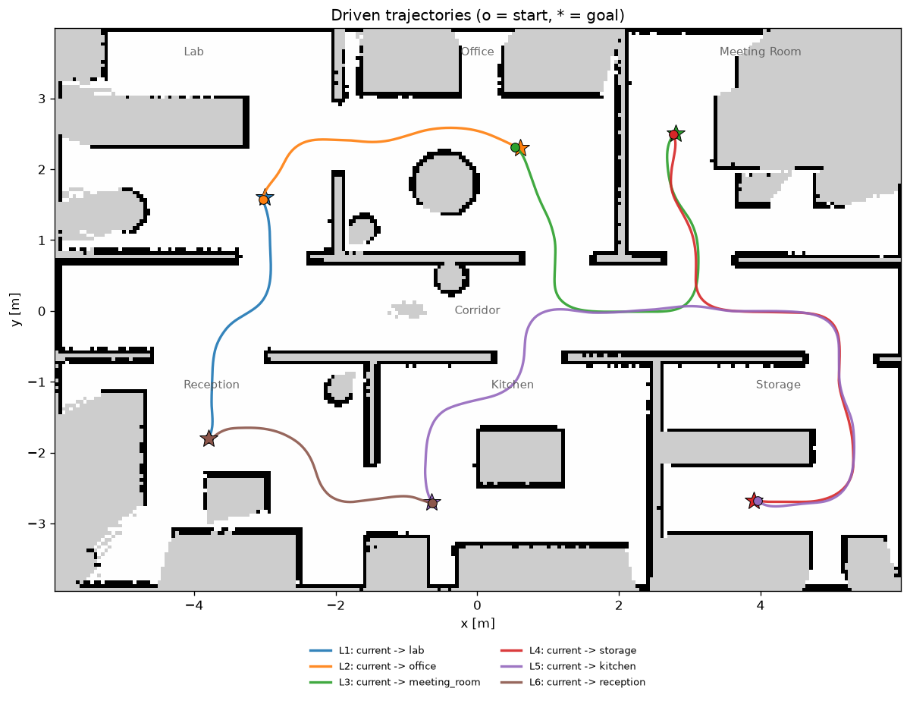
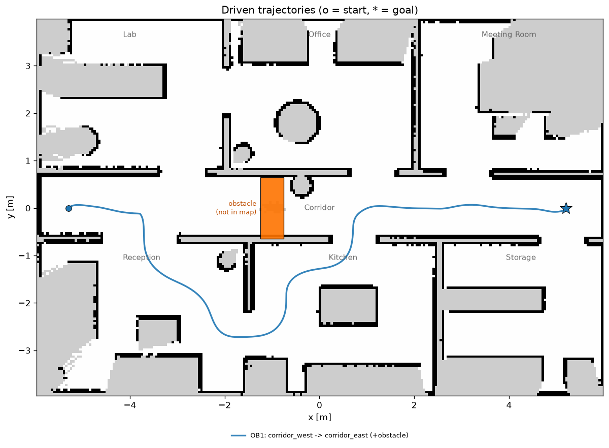

# 4. Evaluation

All runs on this page are stored in [`docs/results/`](results/) (Markdown summary, CSV, JSON with
the full trajectories, plots). They were made with the parameters and code in this repository,
ROS 2 Humble + Gazebo Classic 11, TurtleBot3 Burger, map `maps/indoor_office.yaml`.
Reproduce them with `bash demo.sh`: 4 = full test table, 1 = tour, 3 = obstacle, 5 = mapping.

## 4.1 How it is measured

| Metric | Definition |
|---|---|
| Result | Nav2 `NavigateToPose` outcome; a goal is accepted within 0.06 m / 0.10 rad (by the robot's own estimate) |
| Time | simulation time from sending the goal to the result |
| Driven / planned | length of the driven track / of the global plan computed before moving |
| Pos. / yaw error | goal vs. the robot's **true** final pose (Gazebo ground truth) |
| Loc. error | AMCL estimate vs. true position at the end of the trip |
| Recoveries | Nav2 behaviour-tree recoveries (costmap clear, spin, back-up, wait) |
| Min. clearance | smallest LiDAR range during the trip minus the robot radius |

The final position error combines the goal tolerance (the robot stops as soon as its *estimate*
is within 6 cm) and the localisation error of AMCL.

## 4.2 Full test table T1-T8 (menu option 4)

Every trial starts from a fixed pose (the robot is teleported there and re-localised).

| Test | Route | Result | Time [s] | Driven [m] | Planned [m] | Pos. error [cm] | Yaw error [deg] | Loc. error [cm] | Recoveries | Min. clearance [cm] |
|---|---|---|---|---|---|---|---|---|---|---|
| T1 | Reception -> Lab | reached | 23.5 | 3.71 | 3.88 | 3.2 | 5.0 | - | 0 | 36 |
| T2 | Lab -> Office | reached | 25.9 | 4.06 | 4.26 | 6.6 | 2.1 | 5.6 | 0 | 25 |
| T3 | Office -> Meeting Room | reached | 42.1 | 6.68 | 6.82 | 3.0 | 5.6 | 3.7 | 0 | 37 |
| T4 | Meeting Room -> Storage | reached | 45.7 | 8.08 | 8.50 | 5.3 | 4.0 | 2.4 | 0 | 32 |
| T5 | Storage -> Kitchen | reached | 66.1 | 11.41 | 11.54 | 1.1 | 6.5 | 1.8 | 0 | 27 |
| T6 | Kitchen -> Reception | reached | 25.3 | 3.68 | 4.00 | 4.7 | 7.4 | 3.9 | 0 | 33 |
| T7 | Reception -> Meeting Room | reached | 56.7 | 10.78 | 11.27 | 1.4 | 3.7 | 3.6 | 0 | 27 |
| T8 | Corridor (west) -> Corridor (east) (+ obstacle) | reached | 75.9 | 14.24 | 11.05 | 3.8 | 6.4 | 5.9 | 0 | 25 |

**8/8 goals reached**; final position error **3.6 cm** mean (max 6.6 cm), heading error 5.1° mean, localisation error 3.8 cm mean, 0 recoveries in total.

## 4.3 Room-to-room tour (menu option 1)

Six legs in a row; each leg starts where the previous one ended.

| Test | Route | Result | Time [s] | Driven [m] | Planned [m] | Pos. error [cm] | Yaw error [deg] | Loc. error [cm] | Recoveries | Min. clearance [cm] |
|---|---|---|---|---|---|---|---|---|---|---|
| 1 | Reception -> Lab | reached | 23.6 | 3.72 | 3.88 | 3.9 | 5.1 | 3.8 | 0 | 36 |
| 2 | Lab -> Office | reached | 26.0 | 4.07 | 4.33 | 6.9 | 4.5 | 5.7 | 0 | 25 |
| 3 | Office -> Meeting Room | reached | 41.9 | 6.68 | 6.82 | 3.5 | 4.6 | 1.8 | 0 | 35 |
| 4 | Meeting Room -> Storage | reached | 44.8 | 8.01 | 8.39 | 6.1 | 1.6 | 2.6 | 0 | 33 |
| 5 | Storage -> Kitchen | reached | 66.5 | 11.43 | 11.55 | 1.1 | 5.8 | 3.0 | 0 | 26 |
| 6 | Kitchen -> Reception | reached | 25.3 | 3.68 | 3.96 | 3.7 | 5.4 | 5.0 | 0 | 33 |

**6/6 goals reached**; final position error **4.2 cm** mean (max 6.9 cm), heading error 4.5° mean, localisation error 3.6 cm mean, 0 recoveries in total.

## 4.4 Unmapped obstacle (menu option 3)

The robot starts at the west end of the corridor; the goal is the east end (10.5 m straight).
An orange 0.5 x 1.3 m block that is **not in the map** is placed across the corridor at
x = -1.0 m. The LiDAR sees it from ~3 m, it is drawn into the costmaps, the planner (re-run every
second) switches to the detour through Reception and the Kitchen, and the robot reaches the goal.

| Test | Route | Result | Time [s] | Driven [m] | Planned [m] | Pos. error [cm] | Yaw error [deg] | Loc. error [cm] | Recoveries | Min. clearance [cm] |
|---|---|---|---|---|---|---|---|---|---|---|
| 1 | Corridor (west) -> Corridor (east) (+ obstacle) | reached | 76.6 | 13.80 | 10.88 | 3.6 | 5.4 | 3.5 | 0 | 29 |
| 2 | Corridor (west) -> Corridor (east) (+ obstacle) | reached | 76.9 | 13.77 | 10.87 | 3.9 | 4.9 | 3.2 | 0 | 30 |

**2/2 goals reached**; final position error **3.7 cm** mean (max 3.9 cm), heading error 5.2° mean, localisation error 3.3 cm mean, 0 recoveries in total.

## 4.5 Mapping (menu option 5)

The robot explored the floor on its own (19/19 exploration waypoints reached, 6 min simulated) while SLAM Toolbox built the map.
The new map was then anchored to the floor plan and compared with it:

| Map | Origin correction | Mean wall distance | Within 5 cm | Within 10 cm |
|---|---|---|---|---|
| map built in this run | (-0.03, -0.06) m | 2.2 cm | 98.8 % | 100.0 % |
| map shipped in the package (`maps/indoor_office.yaml`) | (-0.05, -0.02) m (+ AMCL calibration, 4.6) | 2.1 cm | 97.6 % | 100.0 % |

"Wall distance" is how far each occupied cell of the SLAM map is from the nearest wall of the exact
layout (`maps/indoor_office_ground_truth.yaml`, generated together with the world).

## 4.6 Localisation accuracy and AMCL calibration

Every AMCL update was paired with the Gazebo ground-truth pose of the same time stamp
(`/amcl_pose` vs `/odom`, which is the true world pose in Gazebo Classic):

| Map origin | AMCL updates | Mean error | Mean bias (x, y) |
|---|---|---|---|
| anchored to the floor plan only | 354 | 5.9 cm | (-3.4, -4.4) cm |
| + AMCL calibration (shipped) | 1559 | 3.5 cm | (+0.4, +1.0) cm |

The bias had the same sign in every room. Half a cell (2.5 cm) of it is a convention mismatch:
AMCL indexes map cells half a cell lower-left of how `map_server` and the costmaps do. Shifting
the map origin by the measured bias removed it; `demo.sh map` applies the half-cell part to every
new map.

## 4.7 The run in the demo video

Recorded with the Gazebo and RViz windows open (software rendering on a small 2-core machine),
menu option 1 followed by option 3: [tour](results/demo_video_tour/summary.md), [obstacle](results/demo_video_obstacle/summary.md).

**7/7 goals reached**; final position error **5.8 cm** mean (max 10.2 cm), heading error 3.6° mean, localisation error 6.6 cm mean, 43 recoveries in total.

That recording used the behaviour tree's default 20 ms server timeout (under the rendering load it
timed out often and triggered quick costmap-clear recoveries) and the map before the AMCL
calibration. With the 200 ms timeout and the calibrated map, the runs above needed no recoveries.

## 4.8 ROS 2 Jazzy + Gazebo Sim

The same tests on ROS 2 Jazzy + Gazebo Sim Harmonic (Ubuntu 24.04 packages, headless runs plus a check of the RViz + Gazebo Sim windows):

| Test | Result | Run |
|---|---|---|
| Full test table T1-T8 | 8/8 reached, 0 recoveries | [jazzy_evaluation](results/jazzy_evaluation/summary.md) |
| Room-to-room tour | 6/6 reached, 1 recovery (Kitchen -> Reception) | [jazzy_tour](results/jazzy_tour/summary.md) |
| Unmapped obstacle | 1/1 reached, same detour as on Humble | [jazzy_obstacle](results/jazzy_obstacle/summary.md) |
| Autonomous mapping | 19/19 waypoints reached; mapped walls on average 2.5 cm from the floor plan, 98.6 % within 10 cm | - |
| `go_to` | reached, GUI windows and follow camera working | - |

Gazebo Sim's wheel odometry starts at zero, so there is no ground truth there: the errors in these runs are measured against AMCL's own estimate (column `ground_truth` = `amcl_estimate`) and only show that the robot stopped within the goal tolerance. Jazzy-specific fixes that were needed: the collision monitor's LiDAR timeout (0.2 s -> 1.0 s, it stopped the robot), 4 ms physics steps in the Gazebo Sim world (1 ms flooded every node with 1000 `/clock` messages per second), and converting the exploration waypoints into the SLAM map frame, which in Gazebo Sim starts at the spawn pose instead of the world origin.

## 4.9 Notes and limits

* Simulation only: the wheel odometry of Gazebo Classic is nearly perfect, so a real robot will
  localise less precisely and needs a larger goal tolerance.
* The robot stops as soon as it *believes* it is within 6 cm of the goal; the true final error adds
  AMCL's localisation error (2-4 cm on a 5 cm map) to that.
* Planned paths stay in the middle of doors and aisles (inflation 0.6 m); that is why the minimum
  clearance is ~25-35 cm. Without obstacles the driven path is within ~5 % of the planned length
  (in the obstacle runs the plan made before the block is seen is the straight corridor).
